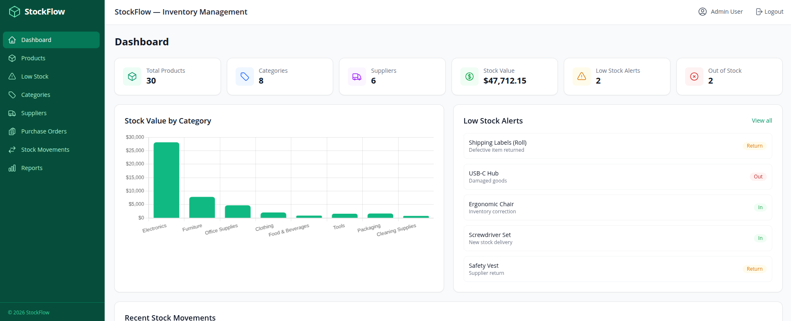
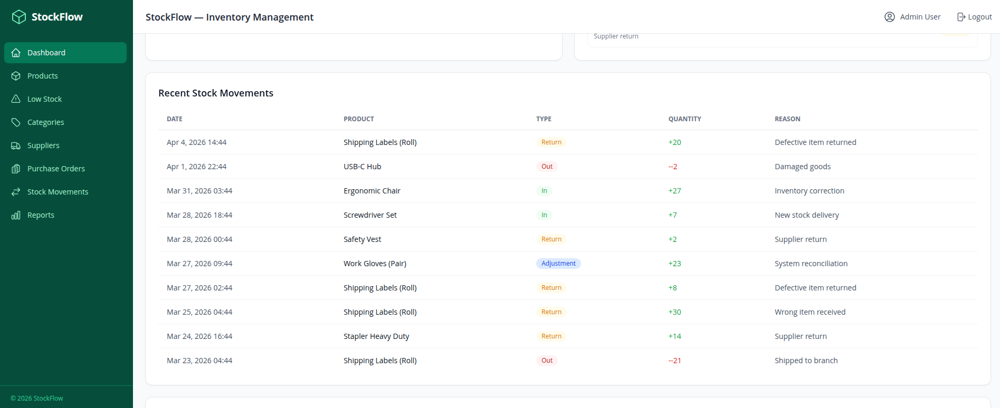
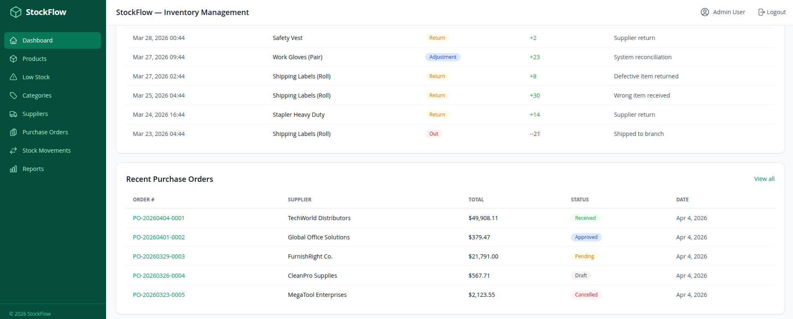
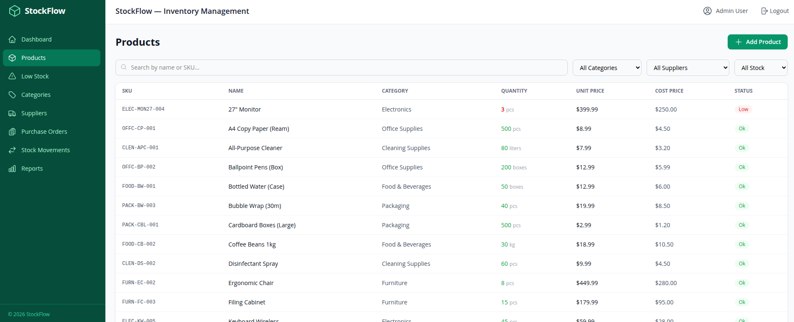
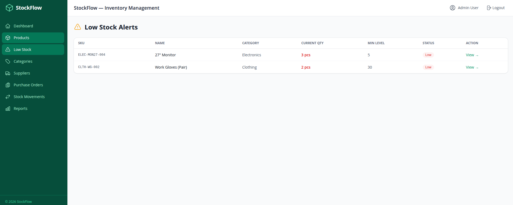
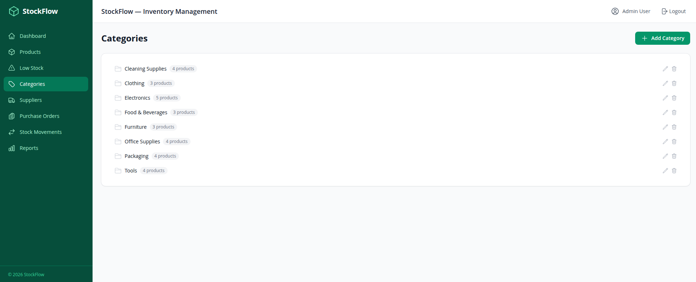
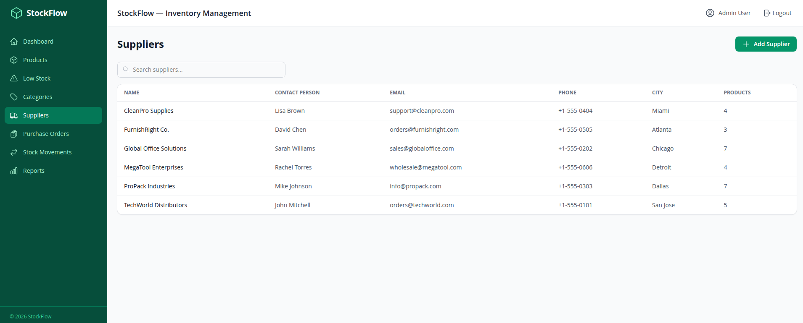
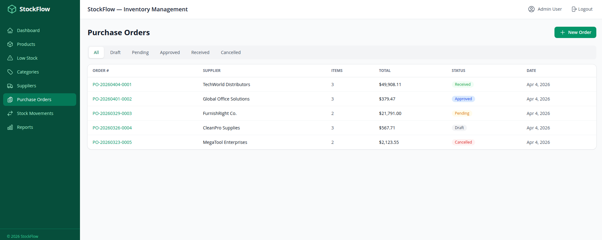
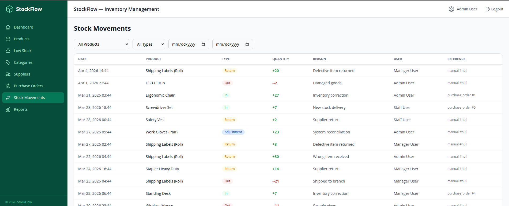
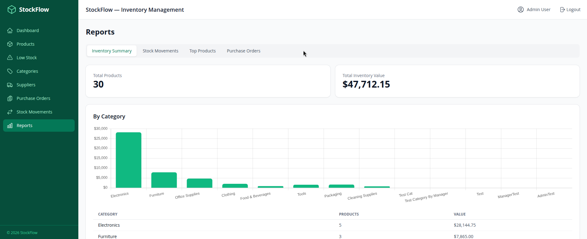

# StockFlow - Inventory Management System

A comprehensive inventory management system built with **Laravel 13** (PHP 8.4), **Vue.js 3** (TypeScript), and **MySQL 8**. Features product management, supplier tracking, purchase orders with auto-stock updates, stock movement history, low stock alerts, and analytical reports with charts.


---










---

## Features

### Product Management
- Full CRUD with search, filtering by category/supplier/stock status
- SKU, barcode, pricing (unit & cost), and location tracking
- Stock level indicators (OK / Low / Out of Stock)
- Min/max stock level configuration
- Soft deletes for data retention

### Category Management
- Hierarchical categories (parent/child)
- Tree view with expand/collapse
- Product count per category

### Supplier Management
- Contact information and address tracking
- Associated products and purchase order history
- Active/inactive status

### Purchase Orders
- Draft → Pending → Approved → Received workflow
- Dynamic line items with auto-calculated totals (10% tax)
- **Auto-stock update** - when an order is marked "Received", product quantities are automatically incremented and stock movements are recorded
- Order cancellation

### Stock Movements
- Full audit trail of all stock changes (in/out/adjustment/return)
- Filter by product, type, and date range
- Reference tracking (manual vs. purchase order)

### Stock Adjustments
- Quick stock in/out/adjustment from product detail page
- Reason tracking for accountability

### Dashboard
- 6 stat cards (products, categories, suppliers, stock value, low stock, out of stock)
- Stock value by category (bar chart)
- Recent stock movements table
- Recent purchase orders table

### Reports
- **Inventory Summary** - totals and breakdown by category with chart
- **Stock Movements** - period-based stats (7/30/90 days) with trend chart
- **Top Products** - by stock value and by movement frequency
- **Purchase Orders** - status breakdown and total spend

### Authentication
- Laravel Sanctum token-based auth
- Role-based users (admin, manager, staff)
- Registration and login pages

---

## Tech Stack

| Layer      | Technology                                    |
|------------|-----------------------------------------------|
| Backend    | PHP 8.4, Laravel 13.x, Sanctum               |
| Frontend   | Vue.js 3, TypeScript, Vite, Tailwind CSS v4   |
| Database   | MySQL 8                                        |
| Charts     | Chart.js via vue-chartjs                       |
| Icons      | Heroicons                                      |
| Container  | Docker, Docker Compose                         |

---

## Prerequisites

- **Docker** and **Docker Compose** installed on your machine
- **Git** (to clone the repository)
- Ports **3000**, **3308**, and **8005** available on your machine

---

## Getting Started

### 1. Clone the Repository

```bash
git clone <repository-url>
cd inventory-management-system
```

### 2. Start the Application

```bash
docker compose up -d --build
```

This will build and start 4 containers:
- **inv-mysql** - MySQL 8 database (port 3308)
- **inv-api** - PHP-FPM 8.4 (Laravel API)
- **inv-nginx** - Nginx reverse proxy for Laravel (port 8005)
- **inv-frontend** - Vue.js SPA served by Nginx (port 3000)

On first start, the entrypoint script will automatically:
1. Run database migrations
2. Seed demo data (3 users, 8 categories, 6 suppliers, 30 products, 5 purchase orders, 50+ stock movements)

### 3. Access the Application

Open your browser and navigate to:

```
http://localhost:3000
```

### 4. Log In

Use one of the demo accounts:

| Role    | Email                        | Password   |
|---------|------------------------------|------------|
| Admin   | admin@inventory.local        | password   |
| Manager | manager@inventory.local      | password   |
| Staff   | staff@inventory.local        | password   |

---

## Project Structure

```
inventory-management-system/
├── api/                        # Laravel 13.x Backend
│   ├── app/
│   │   ├── Http/
│   │   │   ├── Controllers/Api/  # 8 API controllers
│   │   │   ├── Requests/         # Form request validation
│   │   │   └── helpers.php       # Pagination helper
│   │   └── Models/               # 7 Eloquent models
│   ├── database/
│   │   ├── migrations/           # 6 migration files
│   │   └── seeders/              # Database seeder
│   ├── routes/api.php            # API route definitions
│   ├── .env                      # Environment configuration
│   └── composer.json
├── frontend/                   # Vue.js 3 SPA
│   ├── src/
│   │   ├── api/client.ts         # Axios client with auth interceptor
│   │   ├── components/           # Reusable UI components
│   │   ├── pages/                # Page components (13 pages)
│   │   ├── stores/auth.ts        # Pinia auth store
│   │   ├── router/index.ts       # Vue Router config
│   │   └── types/index.ts        # TypeScript interfaces
│   ├── vite.config.ts
│   └── package.json
├── docker/                     # Docker configuration
│   ├── php/                      # PHP-FPM Dockerfile + entrypoint
│   ├── nginx/                    # Laravel Nginx config
│   └── frontend/                 # Frontend Nginx config
├── docker-compose.yml
├── README.md
└── LICENSE
```

---

## API Endpoints

### Authentication
| Method | Endpoint            | Description           |
|--------|---------------------|-----------------------|
| POST   | `/api/auth/register` | Register new user     |
| POST   | `/api/auth/login`    | Login (returns token) |
| POST   | `/api/auth/logout`   | Logout (revoke token) |
| GET    | `/api/auth/me`       | Get current user      |

### Products
| Method | Endpoint                            | Description              |
|--------|-------------------------------------|--------------------------|
| GET    | `/api/products`                     | List products (paginated)|
| POST   | `/api/products`                     | Create product           |
| GET    | `/api/products/{id}`                | Get product detail       |
| PUT    | `/api/products/{id}`                | Update product           |
| DELETE | `/api/products/{id}`                | Soft delete product      |
| GET    | `/api/products/low-stock`           | List low stock products  |
| POST   | `/api/products/{id}/adjust-stock`   | Adjust stock level       |

### Categories
| Method | Endpoint                | Description       |
|--------|-------------------------|--------------------|
| GET    | `/api/categories`       | List categories    |
| POST   | `/api/categories`       | Create category    |
| GET    | `/api/categories/{id}`  | Get category       |
| PUT    | `/api/categories/{id}`  | Update category    |
| DELETE | `/api/categories/{id}`  | Delete category    |

### Suppliers
| Method | Endpoint               | Description       |
|--------|------------------------|--------------------|
| GET    | `/api/suppliers`       | List suppliers (paginated) |
| POST   | `/api/suppliers`       | Create supplier    |
| GET    | `/api/suppliers/{id}`  | Get supplier detail|
| PUT    | `/api/suppliers/{id}`  | Update supplier    |
| DELETE | `/api/suppliers/{id}`  | Delete supplier    |

### Purchase Orders
| Method | Endpoint                                | Description                  |
|--------|-----------------------------------------|------------------------------|
| GET    | `/api/purchase-orders`                  | List orders (paginated)      |
| POST   | `/api/purchase-orders`                  | Create order                 |
| GET    | `/api/purchase-orders/{id}`             | Get order detail             |
| PUT    | `/api/purchase-orders/{id}`             | Update order                 |
| DELETE | `/api/purchase-orders/{id}`             | Delete draft order           |
| PATCH  | `/api/purchase-orders/{id}/status`      | Update order status          |

### Stock Movements
| Method | Endpoint                              | Description                |
|--------|---------------------------------------|----------------------------|
| GET    | `/api/stock-movements`                | List movements (paginated) |
| GET    | `/api/products/{id}/movements`        | Movements for a product    |

### Reports & Dashboard
| Method | Endpoint                        | Description              |
|--------|---------------------------------|--------------------------|
| GET    | `/api/dashboard`                | Dashboard statistics     |
| GET    | `/api/reports`                  | Combined report data     |
| GET    | `/api/reports/inventory-summary`| Inventory summary        |
| GET    | `/api/reports/stock-movements`  | Movement report          |
| GET    | `/api/reports/top-products`     | Top products report      |
| GET    | `/api/reports/purchase-orders`  | Purchase order report    |

---

## Architecture

### Backend (Laravel)
- **Controller → Model** pattern with Form Request validation
- **Sanctum** token-based SPA authentication
- **Eloquent ORM** with eager loading, scopes, and relationships
- **Database transactions** for purchase order receiving (atomically updates stock)
- **Soft deletes** on products for data retention
- **Standardized pagination** helper for consistent API responses

### Frontend (Vue.js)
- **Composition API** with `<script setup>` syntax
- **Pinia** for state management (auth store)
- **Vue Router** with navigation guards (auth/guest)
- **Axios interceptors** for token injection and 401 redirect (using Vue Router, not window.location)
- **Tailwind CSS v4** with `@tailwindcss/vite` plugin
- **Chart.js** for dashboard and report visualizations
- **Heroicons** for consistent iconography

### Docker
- **Multi-stage builds** for frontend (npm build → nginx)
- **Smart entrypoint** for API (migrate + conditional seed on first run)
- **Nginx reverse proxy** pattern: frontend nginx proxies `/api/` to Laravel nginx

---

## Stopping the Application

```bash
cd inventory-management-system
docker compose down
```

To remove all data (including the database volume):

```bash
docker compose down -v
```

---

## Environment Variables

The API `.env` file is pre-configured for Docker. Key settings:

| Variable        | Value                | Description          |
|-----------------|----------------------|----------------------|
| `DB_HOST`       | `mysql`              | MySQL container name |
| `DB_DATABASE`   | `inventory_db`       | Database name        |
| `DB_USERNAME`   | `invuser`            | Database user        |
| `DB_PASSWORD`   | `invpass123`         | Database password    |
| `APP_URL`       | `http://localhost:8005` | Laravel app URL   |

---

## License

MIT License with Attribution Clause

Copyright (c) 2026 aaweb.tech

Permission is hereby granted, free of charge, to any person obtaining a copy of this software and associated documentation files (the "Software"), to deal in the Software without restriction, including without limitation the rights to use, copy, modify, merge, publish, distribute, sublicense, and/or sell copies of the Software, subject to the following conditions:

1. The above copyright notice and this permission notice shall be included in all copies or substantial portions of the Software.

2. **Attribution Clause** - If you use this Software (or any substantial portion of it) for commercial purposes, including but not limited to SaaS products, paid applications, or commercial services, you must:
   - Include a visible link to [https://aaweb.tech](https://aaweb.tech) in your product, website, or documentation with the text: *"Built upon an original idea and codebase from [aaweb.tech](https://aaweb.tech)"*.
   - Mention the original project in your README or equivalent documentation for any public fork or derivative.
   - This attribution would be greatly appreciated and helps support the original creator.

THE SOFTWARE IS PROVIDED "AS IS", WITHOUT WARRANTY OF ANY KIND, EXPRESS OR IMPLIED, INCLUDING BUT NOT LIMITED TO THE WARRANTIES OF MERCHANTABILITY, FITNESS FOR A PARTICULAR PURPOSE AND NONINFRINGEMENT. IN NO EVENT SHALL THE AUTHORS OR COPYRIGHT HOLDERS BE LIABLE FOR ANY CLAIM, DAMAGES OR OTHER LIABILITY, WHETHER IN AN ACTION OF CONTRACT, TORT OR OTHERWISE, ARISING FROM, OUT OF OR IN CONNECTION WITH THE SOFTWARE OR THE USE OR OTHER DEALINGS IN THE SOFTWARE.
